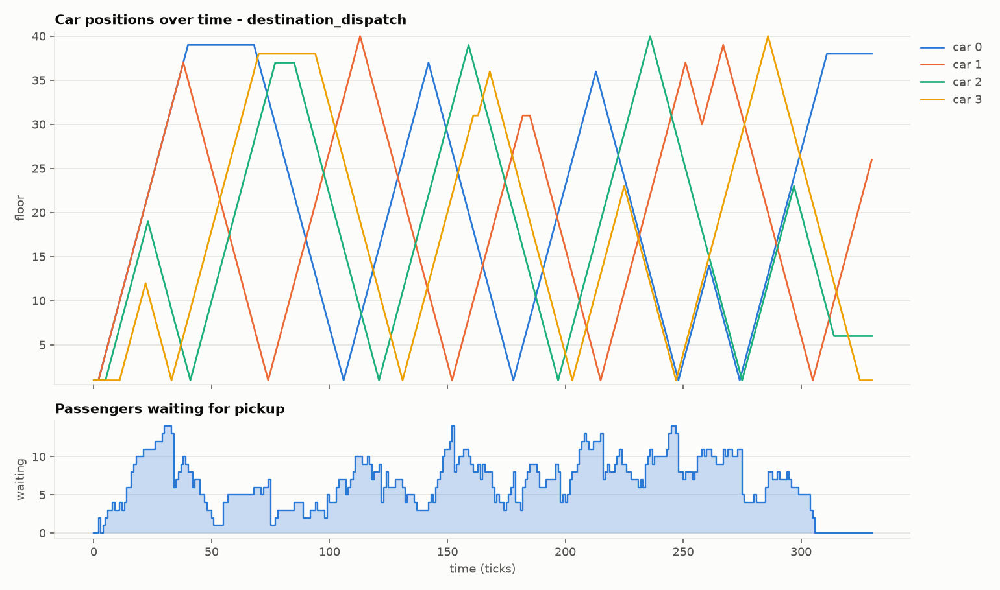
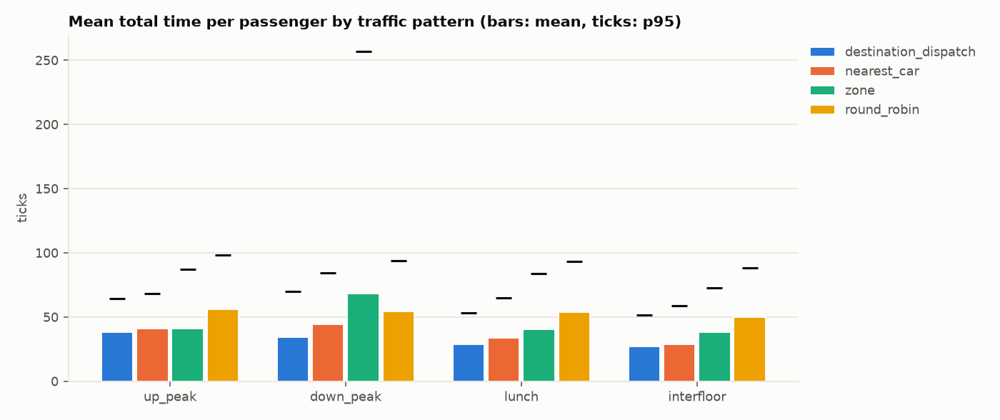
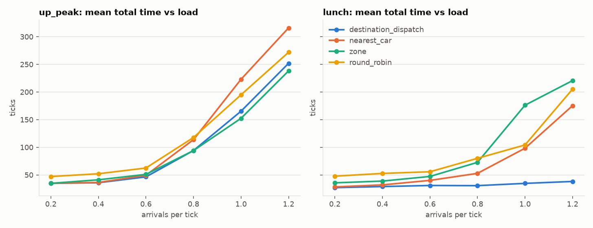
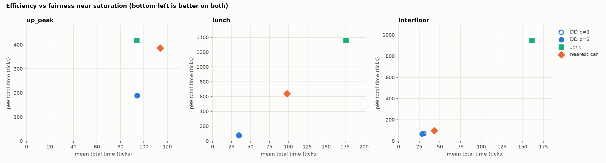
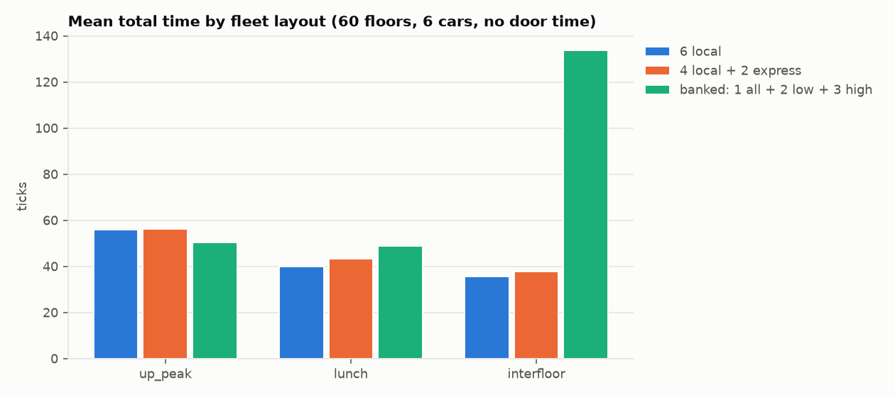

# Elevator System Simulation

A discrete-time simulation of a **destination-dispatch** elevator system. Each passenger
enters an origin and a destination when they call, the controller immediately assigns them
to one car, and the cars move one floor per tick until everyone is delivered.

It includes four dispatch algorithms, express and banked (low-rise/high-rise) cars, a
traffic generator, and an experiment suite that compares the algorithms and explores the
trade-off between fairness and efficiency.



## Quick start

Requires Python 3.9+ (developed on 3.12). The simulator itself has **no dependencies**.
matplotlib (charts) and pytest (tests) are optional.

```bash
python3 -m venv .venv && source .venv/bin/activate
pip install -e ".[dev]"        # or skip this: the simulator runs on the standard library
```

Run the example from the brief:

```bash
python -m elevator_sim run data/example.csv --elevators 2
```

Run a request file with your own building:

```bash
python -m elevator_sim run requests.csv --floors 60 --elevators 4 --capacity 10 --out output --plots
```

Generate synthetic traffic (`up_peak`, `down_peak`, `lunch`, `interfloor`):

```bash
python -m elevator_sim generate --pattern lunch --floors 40 --duration 600 --rate 0.5 --seed 1 -o data/lunch.csv
```

Reproduce every table and chart in [`results/`](results/results.md) (about 1.5 minutes):

```bash
python -m elevator_sim compare
```

Run the tests:

```bash
pytest
```

`python -m elevator_sim run --help` lists every option: `--scheduler`, `--fairness`,
`--stop-time`, `--starvation-threshold`, `--express N`, `--serve CAR:FLOORS`, `--lowest-floor`
and more.

### Input

A CSV with a header, one request per row. Rows don't need to be sorted.

```
time,id,source,dest
0,passenger1,1,51
0,passenger2,1,37
10,passenger3,20,1
```

### Output

`run` writes to `--out` (default `output/`):

| File | Contents |
|---|---|
| `positions.csv` | **Elevator positions log**: one row per tick from t=0, `time,elevator_0,elevator_1,...` |
| `passengers.csv` | Per-passenger car, pickup, drop-off, wait, travel and total time |
| `summary.json` | Every statistic below, machine-readable |
| `elevator_trace.png`, `time_distributions.png` | With `--plots` |

It also prints the **summary statistics**: min, mean, median, p95 and max of wait, travel and
total time, a per-car breakdown, and plain-English observations about the run:

```
metric           min     mean   median      p95     max
wait time          0    14.33      0.0     38.7      43
travel time       19    35.00     36.0     48.6      50
total time        36    49.33     50.0     60.8      62

Observations:
  - All 3 passengers were delivered in 73 ticks.
  - Waiting is 29% of the average total time (mean wait 14.3 vs mean ride 35.0).
  ...
```

## How it works

### Time model

One tick = one floor of travel. Every tick, in this order:

1. Log each car's floor (this becomes the row for time `t` in `positions.csv`).
2. Release requests with `time == t` and assign each to a car. Requests later in the file
   are not visible yet. The scheduler only ever sees the arriving passenger and the cars'
   current state.
3. Step every car: **alight**, **board**, **move** one floor.
4. Stop once every request has been released and delivered; otherwise go to `t + 1`.

The clock always moves one tick at a time, including through quiet stretches.

Definitions: `wait = pickup - request`, `travel = dropoff - pickup`,
`total = dropoff - request = wait + travel`.

### Car behaviour (`elevator.py`)

* **Movement: LOOK.** A car keeps going in its current direction while it has a stop ahead
  (a rider's destination or an assigned pickup), turns around when it runs out, and idles
  when it has no work.
* **Direction rule.** A waiting rider boards only if the car is idle, already going their
  way, or about to turn around because nothing is left ahead. A car going up does not
  scoop up someone going down and drag them to the top floor.
* **Capacity.** Riders board oldest-first until the car is full. The rest wait for the
  car's next pass. The assignment is final (destination dispatch: the screen told you which
  car to take).
* **Anti-starvation guarantee.** Direction and capacity rules can starve someone. A rider
  in the middle of the building can keep finding their car full on the way up and heading
  the wrong way on the way down (`tests/test_simulation.py` reproduces this). So once a
  car's oldest waiting rider has waited longer than `--starvation-threshold` (default
  3 × floors), that rider becomes the car's **VIP**. The car heads for them, and in the
  meantime only takes riders who will get off before reaching the VIP's floor. That
  guarantees there is room when it arrives, and the wait is bounded by roughly the
  threshold plus two sweeps of the building.
* **Door time.** `--stop-time` (default 0) holds a car at a floor for extra ticks whenever
  it stops. The brief only charges for travel, so the default is 0. Experiments that depend
  on stop cost also run with 2.

### Schedulers (`schedulers.py`)

| Name | Idea |
|---|---|
| `destination_dispatch` (default) | **Cost-based assignment by simulation.** For each eligible car, run a copy of the car forward (the same `step()` code the real car uses, with no future requests), once as is and once with the new passenger added. Pick the car whose cost increases least. Cost is `Σ total_time^p` over the car's riders, so it includes the delay the new rider causes for everyone already assigned. Default `p = 2`. |
| `nearest_car` | Classic collective control: the car with the shortest estimated time to reach the caller, given its direction and remaining sweep, with a penalty if it is likely full. |
| `zone` | Contiguous floor bands, each with its own cars. A trip belongs to the zone of its non-lobby end; within the zone, nearest car. |
| `round_robin` | Cars take turns. Ignores state entirely: a lower bound on "smart". |

Because destination dispatch prices an assignment by running the car's real logic, its
cost model can't drift from the car's actual behaviour. Change the boarding rules and the
scheduler automatically accounts for them.

### Express and banked cars

Any car can be restricted to a set of floors: `--serve 3:1,31-60`, or `--express N` for
"the last N cars serve the lobby plus the upper half". Restricted cars run straight through
floors they don't serve. Schedulers only assign trips a car can serve, and the config is
rejected unless every origin/destination pair is served by at least one car (no transfers).

## Results

All numbers come from `python -m elevator_sim compare` (3 seeds per scenario, same traffic
for every scheduler). Full tables: [`results/results.md`](results/results.md).

**1. Destination dispatch has the lowest mean in every traffic pattern at normal load**
(40 floors, 4 cars of 10, 0.5 arrivals/tick):

| mean total time | up-peak | down-peak | lunch | interfloor |
|---|---|---|---|---|
| destination_dispatch | **38.0** | **34.1** | **29.0** | **27.0** |
| nearest_car | 41.0 | 44.6 | 34.1 | 29.0 |
| zone | 41.2 | 68.1 | 40.4 | 38.2 |
| round_robin | 56.3 | 54.3 | 53.7 | 50.2 |



**2. The gap widens with load.** In two-way lunch traffic, destination dispatch goes from
27 to 38 ticks as load rises six-fold. Nearest car goes from 28 to 175. Destination dispatch
knows each rider's destination, so it can put riders heading the same way into the same car.



**3. Fairness vs efficiency.** In an overloaded morning rush, **zoning has a slightly
better mean** (152 vs 165 at 1.0 arrivals/tick) because each car's stops are clustered. But
it starves the unlucky: at 0.8 arrivals/tick its p99 is 418 ticks against 188 for
destination dispatch, and its worst trip is 670 against 212. Nearest car is worse on both
measures. Destination dispatch is the only scheduler that stays near the bottom-left (best
corner) of the chart in every pattern.



* **Cost exponent.** `p = 2` instead of `p = 1` cut the worst trip from 144 to 85 ticks in
  heavy interfloor traffic and slightly *lowered* the mean (30.6 → 28.5). Squaring
  penalises any assignment that leaves someone waiting a long time, which partly makes up
  for the scheduler not knowing about future requests. In up-peak it makes no difference.
* **Starvation threshold.** Setting it too low turns the building into
  first-come-first-served. At 30 ticks, the lunch mean jumps from 35 to 81. At the default
  (120), it costs nothing measurable and caps up-peak's worst wait at 184 ticks versus 338
  with the guard off.

**4. Express cars are a fixed bet on one traffic pattern.**

| mean total time (60 floors, 6 cars) | up-peak | lunch | interfloor |
|---|---|---|---|
| 6 local | 55.9 | **40.0** | **35.6** |
| 4 local + 2 express (lobby + 31-60) | 56.1 | 43.3 | 37.8 |
| banked: 1 all-floor + 2 low-rise + 3 high-rise | **50.3** | 49.0 | 133.8 |

* Express cars that only skip floors buy nothing here. Every floor costs one tick whether
  or not you stop, and destination dispatch already groups riders by destination. All the
  restriction does is take away flexibility.
* Classic low-rise/high-rise **banks** cut up-peak time by 10% (13% with 2-tick door
  time), because each car's stops cluster in half the building. They lose in two-way
  traffic and collapse for interfloor traffic, because every cross-bank trip has to share
  the single all-floor car.



## Assumptions and simplifications

* **Floors** are `1..N` by default, with floor 1 as the lobby (`--lowest-floor 0` if your
  data has a ground floor 0). If `--floors` is omitted it is inferred from the highest
  floor in the input.
* **All cars start at the lobby**, idle.
* **Boarding and alighting are instant** unless `--stop-time` is set.
* **A request is released at its own tick** and can be picked up in that same tick if its
  car is already there (wait 0).
* **Same-floor requests** (`source == dest`) are skipped with a warning. Out-of-range
  floors, negative times and duplicate IDs are rejected.
* **No transfers / sky lobbies:** every trip must be served by a single car.
* **Riders always board their assigned car** and never give up.
* **Cars are never reassigned** after the fact, matching destination dispatch, where the
  passenger is told which car to take.
* **Cars don't reposition when idle.** They stay where they finished.

## Trade-offs I made

* **Projection-based cost over a hand-written formula.** It costs more CPU (each request
  runs two short simulations per car: under a second for ~600 requests at normal load, a
  few seconds when the building is badly overloaded and every car is full), but the cost can never
  disagree with the car's actual behaviour, and it captures the delay imposed on riders
  already assigned. A closed-form estimate would be faster and would drift every time the
  car rules change.
* **Single-car greedy, no lookahead.** Each assignment is optimal given the present, not
  jointly with future arrivals, because the brief forbids peeking. I tried adding an
  opportunity cost for keeping a car busy (`--busy-weight`). It didn't help, so it stays
  off. The fairness exponent turned out to be a cheaper, better proxy.
* **A guarantee rather than a heuristic for starvation.** The VIP rule is simple to reason
  about and testable, at the cost of a little throughput while a VIP is being served.
* **Standard library only for the core,** so reviewers can run it without installing
  anything.

## How long I spent

_TODO: fill in._

## What I'd do with more time

* **Smarter idle parking:** send idle cars to the lobby in the morning and spread them out
  during the day. This is a cheap win in up-peak.
* **Sky lobbies and transfers,** so banked layouts work for interfloor traffic.
* **Realistic kinematics:** acceleration, a top speed above one floor per tick for long
  express runs, door timing that scales with the number of people boarding. That is where
  express cars actually pay off.
* **Batch re-optimisation:** re-solve the assignment of everyone in the same tick jointly,
  or use a small rollout with sampled future traffic in place of the greedy single-car cost.
* **Learn the traffic pattern** from recent requests and switch zoning on or off
  automatically, taking zoning's up-peak gain without paying for it at lunch.
* **An animated or interactive viewer** for `positions.csv`.

## Project layout

```
elevator_sim/
  models.py       Passenger, Request, SimConfig (validation, express coverage check)
  elevator.py     A car: alight / board / move (LOOK), VIP rule, forward projection
  schedulers.py   destination_dispatch, nearest_car, zone, round_robin
  simulation.py   The tick loop
  stats.py        Summary statistics and observations
  io_utils.py     CSV in/out
  traffic.py      Traffic generator, express and banked layouts
  experiments.py  `compare` command
  plots.py        Charts (matplotlib)
  cli.py          Command-line interface
data/example.csv  The example from the brief
results/          Output of `python -m elevator_sim compare`
tests/            pytest suite
```
