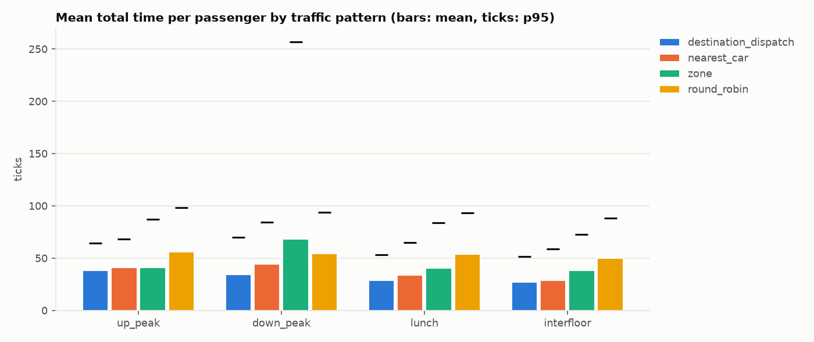
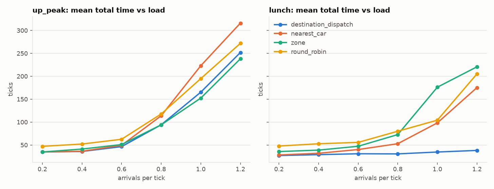
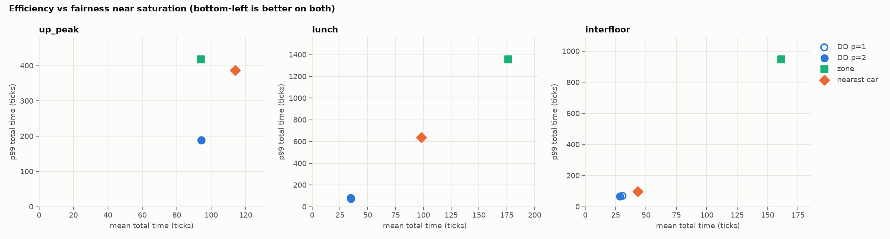
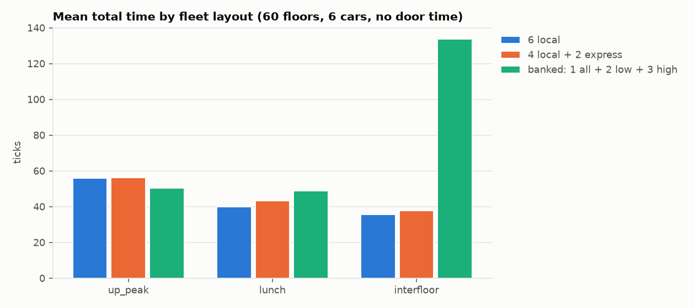
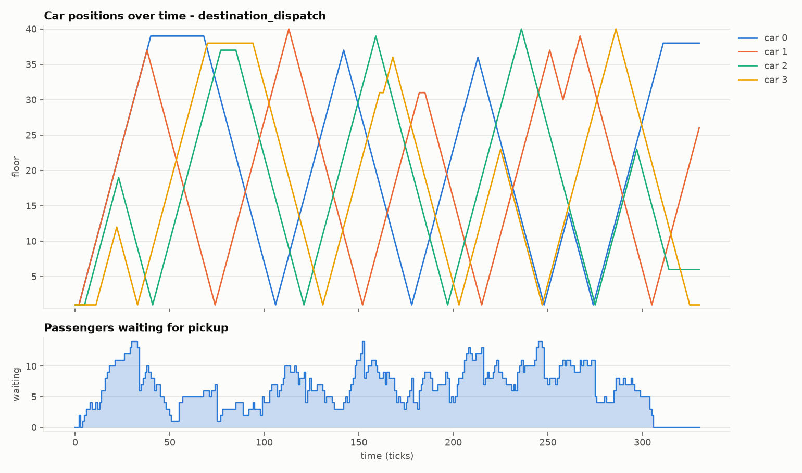
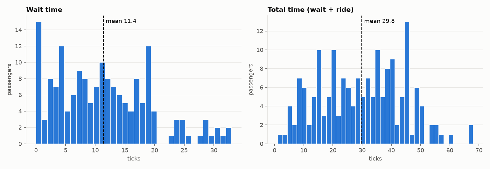

# Experiment results

Generated by `python -m elevator_sim compare` (3 traffic seed(s) per scenario). All times are in ticks (1 tick = 1 floor of travel).

## 1. Scheduler comparison

40 floors, 4 cars of 10, no door time, 0.5 arrivals per tick for 600 ticks.

**up_peak**

| scheduler | mean wait | p95 wait | mean total | p95 total | max total |
|---|---|---|---|---|---|
| destination_dispatch | 19.0 | 36.3 | 38.0 | 64.6 | 83.0 |
| nearest_car | 21.9 | 40.6 | 41.0 | 68.2 | 114.0 |
| zone | 22.1 | 58.9 | 41.2 | 87.1 | 170.0 |
| round_robin | 37.2 | 72.3 | 56.3 | 98.6 | 154.0 |

**down_peak**

| scheduler | mean wait | p95 wait | mean total | p95 total | max total |
|---|---|---|---|---|---|
| destination_dispatch | 15.1 | 38.6 | 34.1 | 69.8 | 96.0 |
| nearest_car | 25.5 | 66.4 | 44.6 | 84.2 | 353.0 |
| zone | 49.1 | 226.1 | 68.1 | 256.9 | 696.0 |
| round_robin | 35.2 | 69.0 | 54.3 | 93.9 | 118.0 |

**lunch**

| scheduler | mean wait | p95 wait | mean total | p95 total | max total |
|---|---|---|---|---|---|
| destination_dispatch | 10.6 | 25.1 | 29.0 | 53.2 | 76.0 |
| nearest_car | 15.6 | 41.5 | 34.1 | 64.9 | 98.0 |
| zone | 22.0 | 55.6 | 40.4 | 84.1 | 199.0 |
| round_robin | 35.3 | 67.0 | 53.7 | 93.4 | 114.0 |

**interfloor**

| scheduler | mean wait | p95 wait | mean total | p95 total | max total |
|---|---|---|---|---|---|
| destination_dispatch | 12.1 | 28.2 | 27.0 | 51.4 | 77.0 |
| nearest_car | 14.1 | 40.9 | 29.0 | 58.8 | 96.0 |
| zone | 23.4 | 54.9 | 38.2 | 72.7 | 100.0 |
| round_robin | 35.4 | 69.0 | 50.2 | 88.6 | 110.0 |

## 2. Load sweep (mean total time)

Same building; arrivals per tick on the rows.

**up_peak**

| rate | destination_dispatch | nearest_car | zone | round_robin |
|---|---|---|---|---|
| 0.2 | 34.8 | 34.9 | 34.8 | 47.2 |
| 0.4 | 36.0 | 36.4 | 41.2 | 52.2 |
| 0.6 | 46.5 | 49.4 | 51.1 | 62.6 |
| 0.8 | 94.2 | 113.9 | 94.1 | 117.8 |
| 1 | 165.4 | 223.0 | 152.5 | 195.0 |
| 1.2 | 251.9 | 316.1 | 238.2 | 271.9 |

**lunch**

| rate | destination_dispatch | nearest_car | zone | round_robin |
|---|---|---|---|---|
| 0.2 | 27.1 | 28.4 | 35.8 | 47.8 |
| 0.4 | 29.0 | 32.0 | 38.9 | 52.8 |
| 0.6 | 31.0 | 40.2 | 47.3 | 55.8 |
| 0.8 | 30.7 | 52.9 | 72.8 | 80.1 |
| 1 | 34.8 | 98.4 | 176.2 | 104.3 |
| 1.2 | 38.3 | 175.4 | 220.7 | 205.3 |

## 3. Fairness vs efficiency

Destination dispatch minimising `sum(total_time ** p)`. p=1 is pure efficiency;
larger p penalises long trips more (the default is p=2). Loads are near or past
saturation, where the tail matters most.

**up_peak, 0.8 arrivals/tick**

| scheduler | mean wait | mean total | p95 total | p99 total | max total | std |
|---|---|---|---|---|---|---|
| DD p=1 | 75.4 | 94.3 | 170.4 | 188.3 | 212.0 | 49.8 |
| DD p=1.5 | 75.3 | 94.3 | 170.6 | 188.6 | 217.0 | 49.8 |
| DD p=2 | 75.3 | 94.2 | 170.3 | 188.0 | 212.0 | 49.6 |
| DD p=3 | 75.2 | 94.1 | 170.5 | 188.3 | 214.0 | 49.8 |
| DD p=4 | 75.4 | 94.3 | 170.0 | 188.0 | 212.0 | 49.8 |
| zone | 75.2 | 94.1 | 345.8 | 418.2 | 670.0 | 107.3 |
| nearest car | 94.9 | 113.9 | 299.6 | 387.1 | 581.0 | 86.9 |

**lunch, 1 arrivals/tick**

| scheduler | mean wait | mean total | p95 total | p99 total | max total | std |
|---|---|---|---|---|---|---|
| DD p=1 | 16.2 | 34.8 | 64.8 | 79.5 | 107.0 | 16.9 |
| DD p=1.5 | 14.7 | 33.3 | 60.5 | 74.2 | 99.0 | 16.0 |
| DD p=2 | 16.1 | 34.8 | 62.9 | 74.4 | 99.0 | 16.3 |
| DD p=3 | 17.5 | 36.2 | 66.6 | 80.6 | 99.0 | 17.5 |
| DD p=4 | 16.3 | 35.0 | 63.4 | 78.3 | 99.0 | 16.8 |
| zone | 157.6 | 176.2 | 932.4 | 1358.1 | 2432.0 | 299.6 |
| nearest car | 79.7 | 98.4 | 377.0 | 637.2 | 1096.0 | 126.8 |

**interfloor, 1 arrivals/tick**

| scheduler | mean wait | mean total | p95 total | p99 total | max total | std |
|---|---|---|---|---|---|---|
| DD p=1 | 15.8 | 30.6 | 58.3 | 69.7 | 144.0 | 16.3 |
| DD p=1.5 | 13.9 | 28.7 | 55.3 | 66.5 | 86.0 | 14.8 |
| DD p=2 | 13.7 | 28.5 | 54.5 | 65.7 | 85.0 | 14.7 |
| DD p=3 | 14.7 | 29.5 | 56.0 | 68.1 | 94.0 | 15.2 |
| DD p=4 | 14.7 | 29.5 | 55.7 | 67.0 | 82.0 | 15.0 |
| zone | 146.5 | 161.3 | 731.2 | 947.9 | 1498.0 | 226.2 |
| nearest car | 28.3 | 43.1 | 83.3 | 99.3 | 158.0 | 23.2 |

### Starvation threshold

Destination dispatch (p=2). Once a car's oldest waiting rider has waited longer than
the threshold, the car heads for them and only takes riders who will get off before
reaching them, so there is guaranteed room. The default is 3 x floors = 120.

**up_peak, 0.8 arrivals/tick**

| threshold | mean wait | mean total | p99 total | max wait | max total |
|---|---|---|---|---|---|
| 30 | 80.3 | 99.2 | 196.7 | 187.0 | 226.0 |
| 60 | 77.7 | 96.6 | 193.9 | 185.0 | 224.0 |
| 120 | 75.3 | 94.2 | 188.0 | 184.0 | 212.0 |
| 240 | 75.2 | 94.2 | 189.6 | 258.0 | 261.0 |
| off | 75.0 | 93.9 | 190.6 | 338.0 | 341.0 |

**lunch, 1 arrivals/tick**

| threshold | mean wait | mean total | p99 total | max wait | max total |
|---|---|---|---|---|---|
| 30 | 62.2 | 80.8 | 234.1 | 380.0 | 419.0 |
| 60 | 16.1 | 34.8 | 73.4 | 77.0 | 99.0 |
| 120 | 16.1 | 34.8 | 74.4 | 77.0 | 99.0 |
| 240 | 16.1 | 34.8 | 74.4 | 77.0 | 99.0 |
| off | 16.1 | 34.8 | 74.4 | 77.0 | 99.0 |

**interfloor, 1 arrivals/tick**

| threshold | mean wait | mean total | p99 total | max wait | max total |
|---|---|---|---|---|---|
| 30 | 30.2 | 45.0 | 131.6 | 172.0 | 207.0 |
| 60 | 13.7 | 28.5 | 65.7 | 69.0 | 85.0 |
| 120 | 13.7 | 28.5 | 65.7 | 69.0 | 85.0 |
| 240 | 13.7 | 28.5 | 65.7 | 69.0 | 85.0 |
| off | 13.7 | 28.5 | 65.7 | 69.0 | 85.0 |

## 4. Express and banked elevators

60 floors, 6 cars of 12, destination dispatch, 0.6 arrivals per tick.
*Express* cars serve the lobby and floors 31-60 and skip 2-30; the other four stop everywhere.
*Banked*: two low-rise cars (1-30), three high-rise cars (lobby + 31-60, express through
the low zone) and one all-floors car for trips between zones.

**up_peak, stop time 0**

| fleet | mean wait | mean total | p95 total | max total |
|---|---|---|---|---|
| 6 local | 27.2 | 55.9 | 93.0 | 116.0 |
| 4 local + 2 express | 27.4 | 56.1 | 94.0 | 124.0 |
| banked: 1 all + 2 low + 3 high | 21.6 | 50.3 | 97.5 | 169.0 |

**lunch, stop time 0**

| fleet | mean wait | mean total | p95 total | max total |
|---|---|---|---|---|
| 6 local | 12.7 | 40.0 | 74.0 | 114.0 |
| 4 local + 2 express | 16.0 | 43.3 | 76.7 | 120.0 |
| banked: 1 all + 2 low + 3 high | 21.7 | 49.0 | 104.5 | 175.0 |

**interfloor, stop time 0**

| fleet | mean wait | mean total | p95 total | max total |
|---|---|---|---|---|
| 6 local | 13.8 | 35.6 | 70.3 | 111.0 |
| 4 local + 2 express | 16.1 | 37.8 | 72.0 | 134.0 |
| banked: 1 all + 2 low + 3 high | 112.1 | 133.8 | 732.8 | 1228.0 |

**up_peak, stop time 2**

| fleet | mean wait | mean total | p95 total | max total |
|---|---|---|---|---|
| 6 local | 38.6 | 78.2 | 130.0 | 198.0 |
| 4 local + 2 express | 40.7 | 79.3 | 128.6 | 169.0 |
| banked: 1 all + 2 low + 3 high | 30.3 | 68.2 | 124.5 | 285.0 |

**lunch, stop time 2**

| fleet | mean wait | mean total | p95 total | max total |
|---|---|---|---|---|
| 6 local | 25.2 | 60.8 | 110.4 | 186.0 |
| 4 local + 2 express | 32.4 | 67.6 | 121.7 | 171.0 |
| banked: 1 all + 2 low + 3 high | 34.9 | 69.3 | 146.6 | 301.0 |

**interfloor, stop time 2**

| fleet | mean wait | mean total | p95 total | max total |
|---|---|---|---|---|
| 6 local | 27.5 | 58.1 | 107.9 | 181.0 |
| 4 local + 2 express | 34.8 | 66.1 | 123.2 | 214.0 |
| banked: 1 all + 2 low + 3 high | 196.2 | 225.9 | 1162.1 | 1708.0 |

## Sanity

Undelivered passengers across every run: 0.

## Charts

